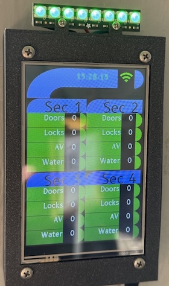
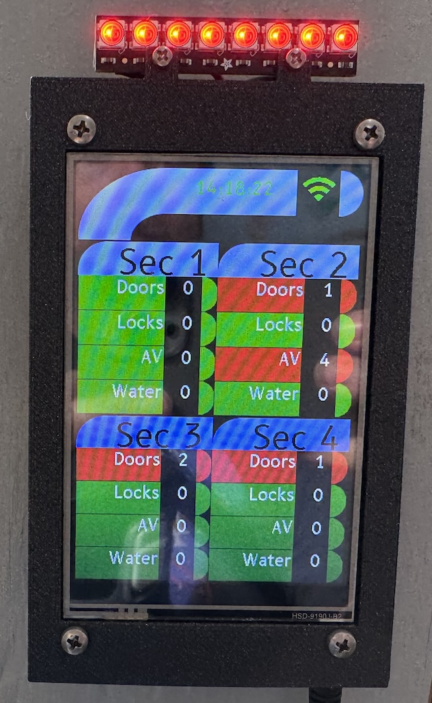
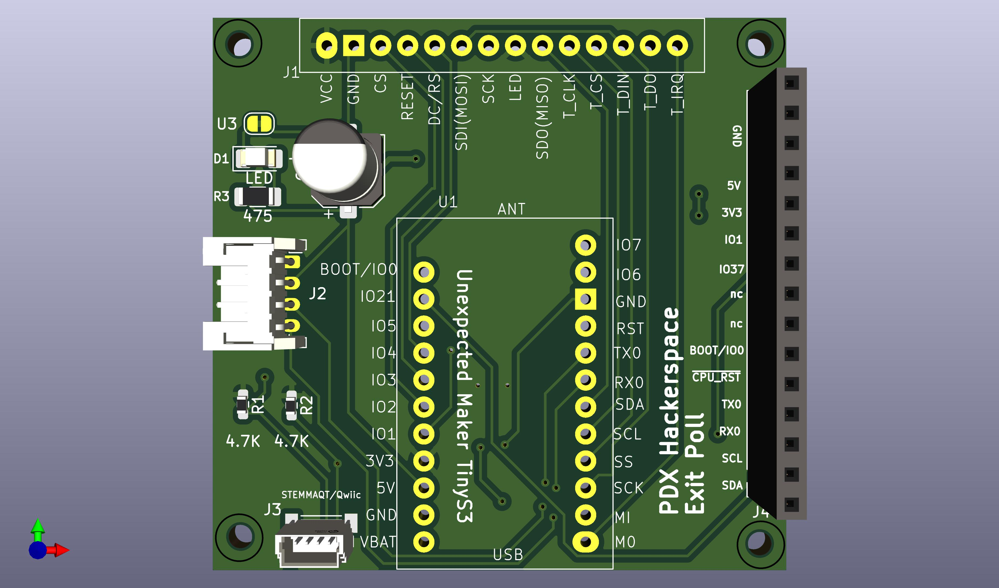
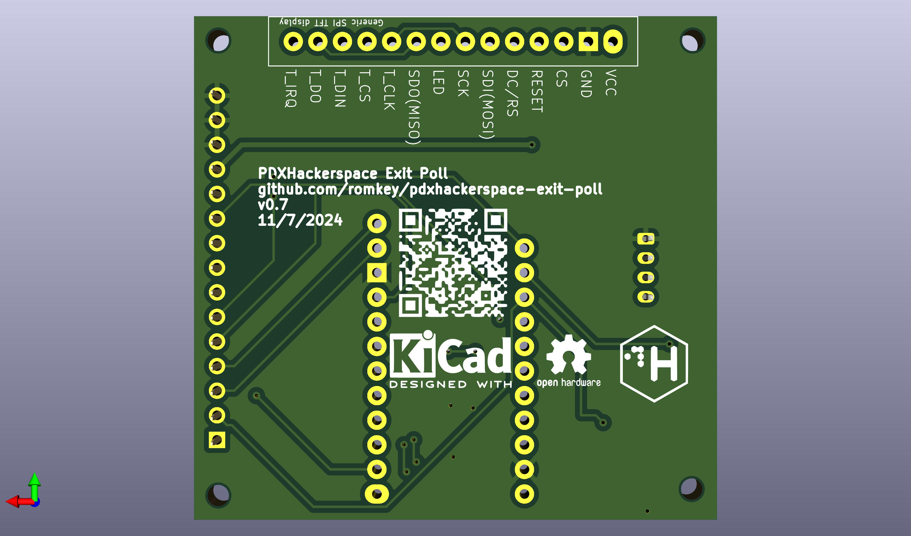
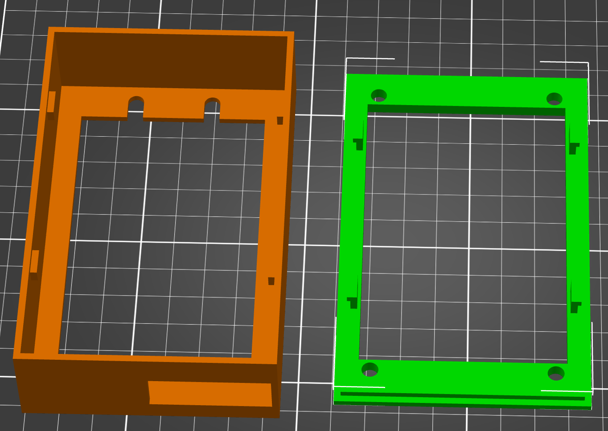

# PDX Hackerspace Exit Poll

[](https://github.com/romkey/pdxhackerspace-exit-poll/actions/workflows/ci.yaml)
[](https://github.com/romkey/pdxhackerspace-exit-poll/actions/workflows/lint.yaml)
[](https://esphome.io/)
[](LICENSE)



Exit Poll is a display next to the door that shows, from Home Assistant,
whether anything in the space needs attention before the last person
leaves: open doors, unlocked doors, running water and AV equipment left on.
At PDX Hackerspace the last person out checks the space's physical security
and turns off equipment; member Kenny M had the idea of putting a dashboard by
the door so departing members can see at a glance whether anything needs
doing. The repo also holds a sibling project, an appliance countdown display
(washer, dryer, dishwasher, oven, 3D printer), built from the same parts.

> **AI disclosure:** This project was written by AI under human oversight,
> following [these rules](https://github.com/romkey/esphome-ai-coding-rules/blob/main/RULES.md).

## What's here

| Path | What it is |
|------|------------|
| [`packages/exit-poll.yaml`](packages/exit-poll.yaml) | Reads the 16 per-section counts from Home Assistant, totals them and publishes a System Status (0 good … 4 urgent) |
| [`packages/exit-poll-leds.yaml`](packages/exit-poll-leds.yaml) | LED strip showing the status as a color, with switches and buttons to override it |
| [`packages/exit-poll-lcars-320x480.yaml`](packages/exit-poll-lcars-320x480.yaml) | LCARS-style screen for a 320x480 SPI panel (mipi_spi) |
| [`packages/exit-poll-lvgl-480x800.yaml`](packages/exit-poll-lvgl-480x800.yaml) | LCARS-style LVGL screen for a 480x800 (portrait) panel |
| [`packages/appliances.yaml`](packages/appliances.yaml) | Reads appliance remaining-time sensors from Home Assistant |
| [`packages/appliances-grid-480x320.yaml`](packages/appliances-grid-480x320.yaml) | 3x2 grid of five appliances plus a clock, 480x320 SPI panel |
| [`packages/appliances-2-line-480x320.yaml`](packages/appliances-2-line-480x320.yaml) | Clock plus washer and dryer in two large rows, 480x320 SPI panel |
| `packages/assets/` | Fonts and LCARS images the display packages use |
| [`examples/tinys3.yaml`](examples/tinys3.yaml) | Exit Poll on a TinyS3 (ESP32-S3) and the Exit Poll PCB, ILI9488 panel |
| [`examples/hosyond-4in-cyd.yaml`](examples/hosyond-4in-cyd.yaml) | Exit Poll on a Hosyond 4" ESP32 display (ESP32, ST7796) |
| [`examples/guition-8048s550.yaml`](examples/guition-8048s550.yaml) | Exit Poll on a Guition 5" ESP32-S3 display, LVGL |
| [`examples/tinypico-appliances.yaml`](examples/tinypico-appliances.yaml) | Appliance grid on a TinyPICO (ESP32) |
| [`examples/hosyond-4in-cyd-appliances.yaml`](examples/hosyond-4in-cyd-appliances.yaml) | Two-line appliance display on the Hosyond 4" board |
| `examples/common/` | Settings shared by all examples, and the Hosyond board |
| [`docs/configuration.md`](docs/configuration.md) | Every package's requirements and substitutions |
| `pcb/` | KiCad files for the TinyS3 carrier PCB |
| `case/` | OpenSCAD and STL files for the 4" case |
| `lcars/` | Source art for the LCARS images |

The examples cover ESP32 and ESP32-S3. There is no ESP32-C3 example: none
of the boards this project runs on uses one.

## Technical details

### How it works

Home Assistant runs the space's security sensors. For each of four sections
of the space it provides four counts, `sensor.total_section_N_doors_open`,
`..._doors_unlocked`, `..._av_on` and `..._water_running`, which Exit Poll
mirrors (the entity ids are substitutions; see
[docs/configuration.md](docs/configuration.md)). The display shows each
count green when zero, red when not, gray when unknown. The LED strip shows
the worst state:

| Status | Meaning | LED color |
|--------|---------|-----------|
| 0 | All good | green |
| 1 | No Wi-Fi | orange |
| 2 | No Home Assistant connection | blue |
| 3 | AV on or water running | yellow |
| 4 | A door open or unlocked | red |

### Hardware

We use a cheap 320x480 SPI TFT display connected to Unexpected Maker's
[TinyS3](https://esp32s3.com/tinys3.html) on a custom PCB, but you can use
virtually any ESP32 board that's fast enough with enough storage and RAM
for your needs. We use displays with touch support - the PCB wires the touch
pins to the CPU but the SPI firmware doesn't use touch yet. The Hosyond and
Guition boards are all-in-one ESP32 displays that need no PCB.

If you want to use a different resolution display you'll need a new display
package.

TinyS3 + Exit Poll PCB wiring ([examples/tinys3.yaml](examples/tinys3.yaml)):

| Signal | GPIO |
|--------|------|
| SPI CLK | 9 |
| SPI MOSI | 36 |
| SPI MISO | 8 |
| Display CS | 2 |
| Display DC | 4 |
| Display reset | 3 |
| LED strip data | 7 |
| I2C SDA (Qwiic) | 21 |
| I2C SCL (Qwiic) | 5 |

The other boards' pins are in their examples, with links to the board
documentation they come from. There are no I2C devices on the SPI boards
(the bus goes to the Qwiic connector); the Guition board's GT911 touch
controller is at 0x5D.

The PCB is available at [OSHPark](https://oshpark.com/shared_projects/85wfS3FQ).



### Assembly

Most of the components on the board are optional.

C1 is entirely optional. It's intended to smooth power to the LED
strip, if you use one. In practice with just a few LEDs it's
unnecessary. We will probably drop it if we update the PCB again.

If you don't want the power indicator, omit D1 and R3.

If you don't want external I2C support via the Qwiic/Stemma QT
connector, omit R1, R2 and J3.

Although the board shows a female header strip for the connections on
the right hand side, ignore it if you're not using those for expansion
or wire them however is convenient for you if you are. You might for
instance wire in buttons for reset and programming (BOOT).

The bare minimum assembly is to solder the TinyS3 to the front of PCB
and then solder the display to the back. Be sure that the pinout of
the display you're using matches the pinout of the holes for its
pins. If it doesn't, you'll need to figure out how to wire it.

### Case

The repo includes [OpenSCAD files](https://openscad.org) for a minimal
case for a 4" display that mounts the display on a frame that snaps
into a box that can be mounted on a wall, with a hole in the bottom
for the USB power cable. If you use a different size display you will
need to redesign the case. It also includes the `.stl` files.

To print the case, load the `.stl` file into the slicer you use with
your 3D printer and follow your printer's instructions to slice and
print the case. PLA and PETG are good materials for the case.



## Building and using

Requires Docker.

```bash
cp examples/secrets.yaml.example examples/secrets.yaml   # then edit it
docker compose run --rm validate
docker compose run --rm build
docker compose run --rm lint
```

The first build downloads the toolchains into a Docker volume; later builds
reuse them and only recompile what changed. `docker compose up dashboard`
runs the ESPHome dashboard on http://localhost:6052.

For your own device, copy an example to `examples/local-<something>.yaml`
(gitignored) and override what you need; it can include the example and
change only a few substitutions:

```yaml
substitutions:
  name: exit-poll
  friendly_name: Exit Poll

packages:
  device: !include hosyond-4in-cyd.yaml
```

Flash it with `docker compose run --rm esphome run examples/local-<something>.yaml`.
Docker Desktop on macOS can't pass USB through: flash the first time with
https://web.esphome.io and use OTA after that.

### Using the packages from your own config

```yaml
substitutions:
  exit_poll_assets: assets   # a copy of packages/assets/ next to your config

packages:
  exit_poll: github://romkey/pdxhackerspace-exit-poll/packages/exit-poll.yaml@v0.4.0
  exit_poll_leds: github://romkey/pdxhackerspace-exit-poll/packages/exit-poll-leds.yaml@v0.4.0
  exit_poll_lcars: github://romkey/pdxhackerspace-exit-poll/packages/exit-poll-lcars-320x480.yaml@v0.4.0
```

ESPHome resolves font and image paths relative to your config, so copy
`packages/assets/` next to it. Your config must provide the ids and pins
each package lists in [docs/configuration.md](docs/configuration.md).

## License

[MIT](LICENSE)
